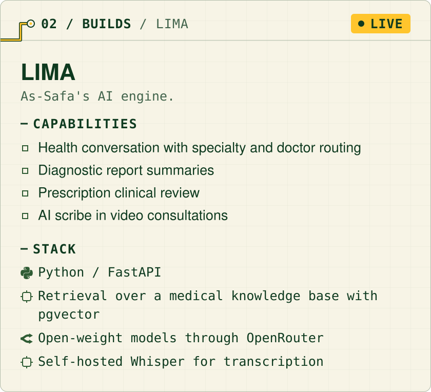
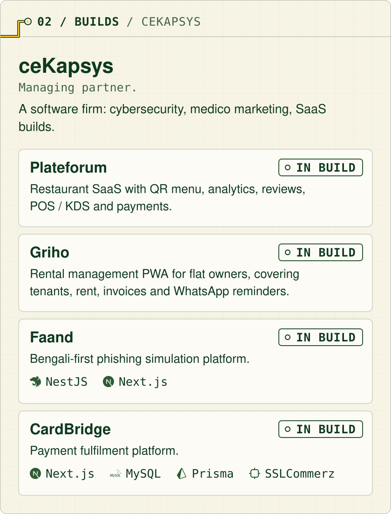
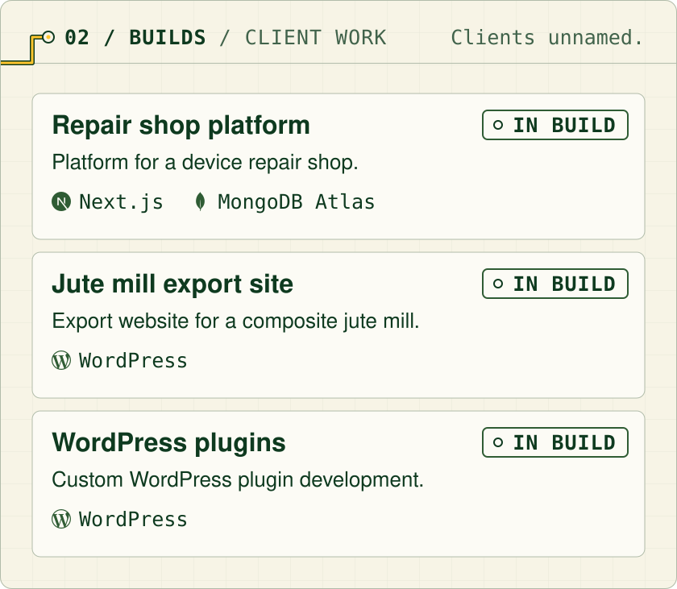
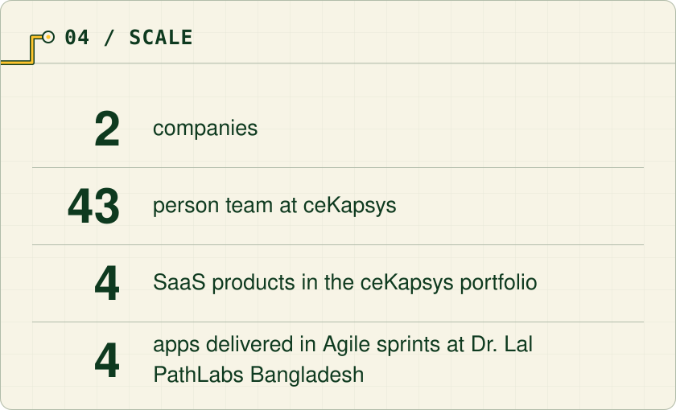
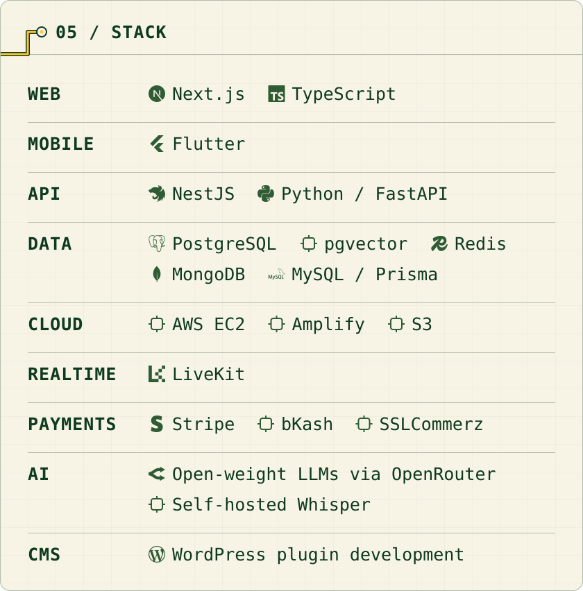

# Emamul Haque

<picture>
  <source media="(prefers-color-scheme: dark)" srcset="assets/hero-dark.svg">
  
</picture>

Technology entrepreneur and product builder in Dhaka, Bangladesh. I run product at As-Safa Inc. and ceKapsys and ship the software behind both: a digital health platform, its AI engine and a portfolio of SaaS products.

[Website](https://emamulhaquecs.com) · [LinkedIn](https://linkedin.com/in/emamulhaquecsq) · [As-Safa](https://as-safa.com) · [ceKapsys](https://cekapsys.com) · [ceKapsys on GitHub](https://github.com/ceKapsys)

## Builds

<picture>
  <source media="(prefers-color-scheme: dark)" srcset="assets/build-as-safa-dark.svg">
  
</picture>

### [As-Safa](https://as-safa.com)

Co-founder and CEO. I lead product. Status: Live.

A unified digital health platform for Bangladesh: diagnostics, telemedicine, corporate wellness, preventive health, pharmacy and health commerce.

- Surfaces: patient app (Flutter), DocDesk doctor portal, HealthDesk corporate health, multi-tenant HRMS.
- Architecture: a PHI firewall enforced at the database layer. Clinical data is never reachable from HR.
- Stack: Next.js, Flutter, NestJS, PostgreSQL, Redis, AWS, LiveKit video, Stripe / bKash / SSLCommerz.

<picture>
  <source media="(prefers-color-scheme: dark)" srcset="assets/build-lima-dark.svg">
  
</picture>

### LIMA

As-Safa's AI engine. Status: Live.

- Health conversation with specialty and doctor routing.
- Diagnostic report summaries.
- Prescription clinical review.
- AI scribe in video consultations.
- Stack: Python / FastAPI, retrieval over a medical knowledge base with pgvector, open-weight models through OpenRouter, self-hosted Whisper for transcription.

<picture>
  <source media="(prefers-color-scheme: dark)" srcset="assets/build-cekapsys-dark.svg">
  
</picture>

### [ceKapsys](https://cekapsys.com)

Managing partner. A software firm: cybersecurity, medico marketing, SaaS builds.

| Product | What it is | Stack | Status |
| --- | --- | --- | --- |
| **Plateforum** | Restaurant SaaS with QR menu, analytics, reviews, POS / KDS and payments. | | In build |
| **Griho** | Rental management PWA for flat owners, covering tenants, rent, invoices and WhatsApp reminders. | | In build |
| **Faand** | Bengali-first phishing simulation platform. | NestJS, Next.js | In build |
| **CardBridge** | Payment fulfilment platform. | Next.js, MySQL, Prisma, SSLCommerz | In build |

<picture>
  <source media="(prefers-color-scheme: dark)" srcset="assets/build-client-dark.svg">
  
</picture>

### Client work

Clients unnamed.

| Build | Stack | Status |
| --- | --- | --- |
| Device repair shop platform | Next.js, MongoDB Atlas | In build |
| Export website for a composite jute mill | WordPress | In build |
| Custom WordPress plugins | WordPress | In build |

## Delivery

<picture>
  <source media="(prefers-color-scheme: dark)" srcset="assets/delivery-dark.svg">
  
</picture>

Discover → Spec (SRD / PRD) → Build → QA on dev → Release to production.

- Planning: ClickUp.
- Source and review: GitHub.
- Build: Claude Code.
- Environments: separate dev and production. Fixes land on dev first.

## Scale

<picture>
  <source media="(prefers-color-scheme: dark)" srcset="assets/scale-dark.svg">
  
</picture>

- 2 companies.
- 43-person team at ceKapsys.
- 4 SaaS products in the ceKapsys portfolio.
- 4 apps delivered in Agile sprints at Dr. Lal PathLabs Bangladesh.

## Stack

<picture>
  <source media="(prefers-color-scheme: dark)" srcset="assets/stack-dark.svg">
  
</picture>

| Layer | Tools |
| --- | --- |
| Web | Next.js, TypeScript |
| Mobile | Flutter |
| API | NestJS, Python / FastAPI |
| Data | PostgreSQL, pgvector, Redis, MongoDB, MySQL / Prisma |
| Cloud | AWS EC2, Amplify, S3 |
| Realtime | LiveKit |
| Payments | Stripe, bKash, SSLCommerz |
| AI | Open-weight LLMs via OpenRouter, self-hosted Whisper |
| CMS | WordPress plugin development |

## Contact

Research interests: health cybersecurity, Bangladesh healthtech, emerging-market product.

<a href="https://emamulhaquecs.com">
  <picture>
    <source media="(prefers-color-scheme: dark)" srcset="assets/footer-dark.svg">
    
  </picture>
</a>

**[Book a call](https://emamulhaquecs.com)**

Most of this work lives in private and organisation repositories. Every panel on this page is an SVG generated from <a href="data/profile.json">one data file</a> by <a href="scripts/build.mjs">a zero-dependency build script</a>. No trackers, no third-party widgets.
